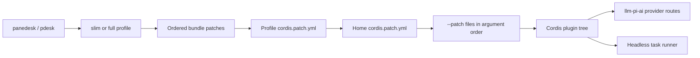

# Panedesk architecture

English | [中文](architecture.zh.md)

Reference for the public presets, patch order, and provider overlays. The [upstream architecture](../architecture.md) describes Cordis services and the agent loop.



## Presets

The [profile templates](../../packages/boot/app-boot/src/profile.ts) select `@panedesk/slim-base` then `@panedesk/slim-headless` for `slim`, and `@panedesk/dsh-base` then `@panedesk/dsh-headless` for `full`. The launcher includes slim; full needs the optional `@panedesk/full` carrier installed beside it. Neither preset is the Web or desktop profile.

The generated table lists base plugin declarations before headless patches, platform conditions, and user overlays; it counts rows, not enabled plugins or installed packages. Slim keeps the provider-neutral task, shell, filesystem, subagent, session-ledger, cache, compaction, and spill services. Full also declares the upstream account, API, telemetry, skill, workflow, and other services shown below; declarations do not imply that every service is enabled.

<!-- BEGIN GENERATED preset-table -->
slim: 42 rows; full: 101 rows

| Row | Plugin export | slim | full |
| --- | --- | --- | --- |
| `tool-plugin-manager` | `@panedesk/dsh-plugin-manager/tools` | no | yes |
| `plugin-manager` | `@panedesk/dsh-plugin-manager` | no | yes |
| `timer` | `@panedesk/cordis-plugin-timer` | no | yes |
| `hmr` | `@panedesk/dsh-hmr` | no | yes |
| `llm` | `@panedesk/dsh-llm` | yes | yes |
| `deepseek-llm-api-extensions` | `@panedesk/dsh-deepseek-llm-api-extensions` | no | yes |
| `session` | `@panedesk/dsh-session` | yes | yes |
| `session-ledger` | `@panedesk/dsh-session-ledger/messages` | yes | yes |
| `session-ledger-full` | `@panedesk/dsh-session-ledger` | yes | yes |
| `llm-cache` | `@panedesk/dsh-llm-cache` | yes | yes |
| `message-delivery` | `@panedesk/dsh-message-delivery-local` | yes | yes |
| `instruction-subscriptions` | `@panedesk/dsh-instruction-subscriptions` | yes | yes |
| `session-log-deepseek` | `@panedesk/dsh-session-log-deepseek` | no | yes |
| `typert` | `@panedesk/dsh-typert-registry` | no | yes |
| `typert-loader` | `@panedesk/dsh-typert-loader` | no | yes |
| `typert-gateway` | `@panedesk/dsh-api-gateway` | no | yes |
| `remote-access` | `@panedesk/dsh-api-remote-access` | no | yes |
| `session-title` | `@panedesk/dsh-session-title` | no | yes |
| `session-title-llm` | `@panedesk/dsh-session-title-first-prompt-llm` | no | yes |
| `user-questions` | `@panedesk/dsh-user-questions` | no | yes |
| `agent` | `@panedesk/dsh-agent` | yes | yes |
| `plugin-package-inventory-deepseek` | `@panedesk/dsh-plugin-package-inventory-deepseek` | no | yes |
| `agent-default-model` | `@panedesk/dsh-agent-default-model` | yes | yes |
| `jobs` | `@panedesk/dsh-jobs-local` | no | yes |
| `llm-retry` | `@panedesk/dsh-llm-retry` | yes | yes |
| `config-editor` | `@panedesk/dsh-config-editor` | no | yes |
| `settings` | `@panedesk/dsh-settings` | no | yes |
| `authorization` | `@panedesk/dsh-authorization` | no | yes |
| `deepseek-account` | `@panedesk/dsh-deepseek-account-platform` | no | yes |
| `credentials` | `@panedesk/dsh-credentials-local` | no | yes |
| `llm-pi-ai` | `@panedesk/dsh-llm-pi-ai` | yes | yes |
| `session-persistence-jsonl` | `@panedesk/dsh-session-persistence-jsonl` | yes | yes |
| `attachment-local` | `@panedesk/dsh-attachment-local` | no | yes |
| `session-query-sqlite` | `@panedesk/dsh-session-query-sqlite` | no | yes |
| `working-directory` | `@panedesk/dsh-working-directory` | yes | yes |
| `tool-working-directory` | `@panedesk/dsh-tool-working-directory` | no | yes |
| `session-projection` | `@panedesk/dsh-session-projection` | yes | yes |
| `storage` | `@panedesk/dsh-storage` | no | yes |
| `storage-json` | `@panedesk/dsh-storage-json` | no | yes |
| `storage-domain` | `@panedesk/dsh-storage-domain` | no | yes |
| `session-projection-cache` | `@panedesk/dsh-session-projection-cache` | no | yes |
| `otel` | `@panedesk/dsh-otel` | no | yes |
| `session-telemetry-otel` | `@panedesk/dsh-session-telemetry-otel` | no | yes |
| `subprocess` | `@panedesk/dsh-subprocess-local` | yes | yes |
| `sandbox` | `@panedesk/dsh-sandbox-local` | yes | yes |
| `sandbox-policy` | `@panedesk/dsh-sandbox-policy` | yes | yes |
| `bash-sandbox` | `@panedesk/dsh-bash-sandbox` | yes | yes |
| `pwsh-sandbox` | `@panedesk/dsh-pwsh-sandbox` | yes | yes |
| `approval` | `@panedesk/dsh-user-approval` | yes | yes |
| `permission` | `@panedesk/dsh-permission-presets` | yes | yes |
| `shell-env` | `@panedesk/dsh-shell-env` | yes | yes |
| `tool-bash` | `@panedesk/dsh-tool-bash` | yes | yes |
| `tool-pwsh` | `@panedesk/dsh-tool-pwsh` | yes | yes |
| `tool-jobs` | `@panedesk/dsh-tool-jobs` | no | yes |
| `fs-observation-policy` | `@panedesk/dsh-fs-observation-policy` | yes | yes |
| `tool-fs` | `@panedesk/dsh-tool-fs` | yes | yes |
| `tool-fs-search` | `@panedesk/dsh-tool-fs-search` | yes | yes |
| `agent-instructions` | `@panedesk/dsh-agent-instructions` | yes | yes |
| `skill` | `@panedesk/dsh-skill` | no | yes |
| `skill-filesystem` | `@panedesk/dsh-skill-filesystem` | no | yes |
| `tool-skill` | `@panedesk/dsh-tool-skill` | no | yes |
| `commands` | `@panedesk/dsh-commands` | no | yes |
| `command-feedback` | `@panedesk/dsh-command-feedback` | no | yes |
| `goal` | `@panedesk/dsh-goal` | no | yes |
| `goal-round-driver` | `@panedesk/dsh-goal-round-driver` | no | yes |
| `command-goal` | `@panedesk/dsh-command-goal` | no | yes |
| `plan-mode` | `@panedesk/dsh-plan-mode` | no | yes |
| `token-meter` | `@panedesk/dsh-token-meter` | yes | yes |
| `compaction-basic` | `@panedesk/dsh-compaction-basic` | yes | yes |
| `command-compact` | `@panedesk/dsh-command-compact` | no | yes |
| `subagent` | `@panedesk/dsh-subagent` | yes | yes |
| `subagent-spawn-in-process` | `@panedesk/dsh-subagent-spawn-in-process` | yes | yes |
| `subagent-fork-in-process` | `@panedesk/dsh-subagent-fork-in-process` | no | yes |
| `tool-subagent-control` | `@panedesk/dsh-tool-subagent-control` | no | yes |
| `tool-subagent-list-agents` | `@panedesk/dsh-tool-subagent-control/list-agents` | no | yes |
| `tool-subagent` | `@panedesk/dsh-tool-subagent` | yes | yes |
| `tool-subagent-fork` | `@panedesk/dsh-tool-subagent` | no | yes |
| `ptc-runtime` | `@panedesk/dsh-ptc-runtime-node` | no | yes |
| `workflow-ptc` | `@panedesk/dsh-workflow-ptc` | no | yes |
| `tool-workflow` | `@panedesk/dsh-tool-workflow` | no | yes |
| `timeout-policy` | `@panedesk/dsh-tool-call-timeout-policy` | yes | yes |
| `spill-local` | `@panedesk/dsh-spill-local` | yes | yes |
| `spill-policy` | `@panedesk/dsh-spill-policy` | yes | yes |
| `session-checkpoint-policy` | `@panedesk/dsh-session-checkpoint-policy` | yes | yes |
| `tool-result-pruner` | `@panedesk/dsh-compaction-tool-result-pruner` | yes | yes |
| `image-offload` | `@panedesk/dsh-compaction-image-offload` | no | yes |
| `tool-todo` | `@panedesk/dsh-tool-todo` | no | yes |
| `tool-goal` | `@panedesk/dsh-tool-goal` | no | yes |
| `repeat-tool-reminder` | `@panedesk/dsh-repeat-tool-reminder` | no | yes |
| `web` | `@panedesk/dsh-web` | no | yes |
| `web-search-deepseek` | `@panedesk/dsh-web-search-deepseek` | no | yes |
| `web-deepseek-api` | `@panedesk/dsh-web-deepseek-api` | no | yes |
| `web-fetch-http` | `@panedesk/dsh-web-fetch-http` | no | yes |
| `tool-web` | `@panedesk/dsh-tool-web` | no | yes |
| `mcp-resources` | `@panedesk/dsh-mcp-resources` | no | yes |
| `tools` | `@panedesk/dsh-tools` | yes | yes |
| `system-prompt` | `@panedesk/dsh-system-prompt` | yes | yes |
| `agent-loop` | `@panedesk/dsh-agent-loop` | yes | yes |
| `fs-sandbox` | `@panedesk/dsh-fs-sandbox` | yes | yes |
| `llm-deepseek` | `@panedesk/dsh-llm-deepseek-api-key` | no | yes |
| `llm-deepseek-account` | `@panedesk/dsh-llm-deepseek-account` | no | yes |
<!-- END GENERATED preset-table -->

Both headless bundles insert `headless-startup` (`@panedesk/dsh-headless/startup`) and `headless-runner` (`@panedesk/dsh-headless`), and override the prompt persona and tools mode. Full headless additionally disables `hmr`, `credentials`, `authorization`, and `deepseek-account`. Slim omits those base rows, hides the harness identity, and requires an explicitly configured default model route. See the [slim headless patch](../../packages/bundle/slim-headless/cordis.patch.yml) and [full headless patch](../../packages/bundle/headless/cordis.patch.yml).

Generate the table with `pnpm exec tsx scripts/panedesk/gen-slim-base.ts --table`; update both pages with `--table --write`. `pnpm run verify-preset-table`, included in `pnpm run doc-sync`, rejects either stale page.

## Patch order

The [dump implementation](../../apps/cli/src/dump-config.ts) reads bundle patches in profile order, then the profile's `cordis.patch.yml`, then `$PANEDESK_HOME/cordis.patch.yml`, then repeated `--patch` files in argument order. Later patches apply to the earlier tree; they are Cordis patch operations, not a generic YAML deep merge. Profile roots start empty. Telemetry command-line flags add a final boot-only layer, outside this dump sequence.

The automatic home filename is `cordis.patch.yml`, not `local.patch.yml`. A file named `local.patch.yml` is only loaded if passed explicitly with `--patch`; its position is that argument's position. Overlay paths are relative to the invoking directory. See the [configuration primer](../cordis-primer.md#loader-configuration).

```sh
pnpm panedesk --profile slim --patch examples/providers/openai-chat.yml --dump-config
pnpm panedesk --profile slim --patch first.patch.yml --patch local.patch.yml --dump-config
pnpm panedesk --profile slim --dump-default-config
```

`--dump-config` prints the assembled configuration without booting plugins or making model requests, and leaves `!!js` expressions unevaluated. `--dump-default-config` ignores profile, home, and argument overlays, including malformed user patches. Dumps can reveal configured values: inspect them locally and redact credentials before sharing. See the [CLI reference](../cli-help.md).

## Provider overlay fields

The [provider schema](../../packages/llm/llm-pi-ai/src/config.ts) defines `llm-pi-ai.config.providers` as a dictionary keyed by route name. These are the fields needed for a typical explicit endpoint; the [adapter reference](../../packages/llm/llm-pi-ai/README.md) owns the remaining options and defaults. An empty dictionary leaves the adapter dormant.

| Field | Type | Required | Example |
| --- | --- | --- | --- |
| `providers.<route>` | provider object | Only when declaring a route | `my-openai-gateway` |
| `apiKeyEnv` | string, credential reference | No; when environment credentials are used | `MY_GATEWAY_API_KEY` |
| `displayName` | nonempty string | No | `My gateway` |
| `api` | supported protocol enum | For a non-catalog route | `openai-completions` |
| `baseURL` | nonempty string | For a non-catalog route | `https://gateway.example.com/v1` |
| `models` | model object array | For a non-catalog route | `[{ id: my-model }]` |
| `models[].id` | string | Yes, for each declared model | `my-model` |
| `models[].name` | string | No | `My model` |
| `models[].contextWindow` | positive integer | No | `200000` |
| `models[].maxTokens` | positive integer | No | `8192` |
| `models[].input` | modality array; empty inherits defaults | No | `[text]` |
| `models[].reasoningEfforts` | `false` or effort-to-wire-value dictionary | No | `false` |

```yaml
- id: llm-pi-ai
  config:
    providers:
      my-openai-gateway:
        api: openai-completions
        baseURL: https://gateway.example.com/v1
        apiKeyEnv: MY_GATEWAY_API_KEY
        models:
          - id: my-model
            contextWindow: 200000
            maxTokens: 8192
            input: [text]
            reasoningEfforts: false
- id: agent-default-model
  config:
    provider: my-openai-gateway
    model: my-model
```

Keep API key values out of overlays: `apiKeyEnv` names the environment variable, not its value. The `agent-default-model` row selects a provider route and model; defining a route alone does not select it. The [OpenAI Chat Completions](../../examples/providers/openai-chat.yml) and [Anthropic Messages](../../examples/providers/anthropic-messages.yml) templates show complete examples.
