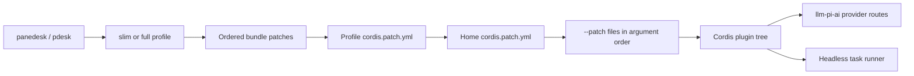

# Panedesk 架构

[English](architecture.md) | 中文

本文是公开预设、补丁顺序与 provider 叠加配置的参考。[上游架构](../architecture.zh.md)介绍 Cordis 服务和 agent loop（智能体循环）。



## 预设

[profile 模板](../../packages/boot/app-boot/src/profile.ts)为 `slim` 依次选择 `@panedesk/slim-base`、`@panedesk/slim-headless`，为 `full` 依次选择 `@panedesk/dsh-base`、`@panedesk/dsh-headless`。启动器自带 slim；full 需要在启动器旁安装可选的 `@panedesk/full` 依赖载体。这两种预设均不是 Web 或桌面 profile。

生成表列出 headless 补丁、平台条件与用户叠加配置生效前的底座插件声明；统计的是行，不是已启用插件或已安装包。Slim 保留协议中立的任务、shell、文件系统、subagent、会话账本、缓存、压缩与 spill 服务。Full 还声明下表中的上游账号、API、遥测、skill（技能）、工作流等服务；有声明并不意味着每项服务均已启用。

<!-- BEGIN GENERATED preset-table -->
slim: 42 rows; full: 101 rows

| Row | Plugin export | slim | full |
| --- | --- | --- | --- |
| `tool-plugin-manager` | `@panedesk/dsh-plugin-manager/tools` | no | yes |
| `plugin-manager` | `@panedesk/dsh-plugin-manager` | no | yes |
| `timer` | `@panedesk/cordis-plugin-timer` | no | yes |
| `hmr` | `@panedesk/dsh-hmr` | no | yes |
| `llm` | `@panedesk/dsh-llm` | yes | yes |
| `deepseek-llm-api-extensions` | `@panedesk/dsh-deepseek-llm-api-extensions` | no | yes |
| `session` | `@panedesk/dsh-session` | yes | yes |
| `session-ledger` | `@panedesk/dsh-session-ledger/messages` | yes | yes |
| `session-ledger-full` | `@panedesk/dsh-session-ledger` | yes | yes |
| `llm-cache` | `@panedesk/dsh-llm-cache` | yes | yes |
| `message-delivery` | `@panedesk/dsh-message-delivery-local` | yes | yes |
| `instruction-subscriptions` | `@panedesk/dsh-instruction-subscriptions` | yes | yes |
| `session-log-deepseek` | `@panedesk/dsh-session-log-deepseek` | no | yes |
| `typert` | `@panedesk/dsh-typert-registry` | no | yes |
| `typert-loader` | `@panedesk/dsh-typert-loader` | no | yes |
| `typert-gateway` | `@panedesk/dsh-api-gateway` | no | yes |
| `remote-access` | `@panedesk/dsh-api-remote-access` | no | yes |
| `session-title` | `@panedesk/dsh-session-title` | no | yes |
| `session-title-llm` | `@panedesk/dsh-session-title-first-prompt-llm` | no | yes |
| `user-questions` | `@panedesk/dsh-user-questions` | no | yes |
| `agent` | `@panedesk/dsh-agent` | yes | yes |
| `plugin-package-inventory-deepseek` | `@panedesk/dsh-plugin-package-inventory-deepseek` | no | yes |
| `agent-default-model` | `@panedesk/dsh-agent-default-model` | yes | yes |
| `jobs` | `@panedesk/dsh-jobs-local` | no | yes |
| `llm-retry` | `@panedesk/dsh-llm-retry` | yes | yes |
| `config-editor` | `@panedesk/dsh-config-editor` | no | yes |
| `settings` | `@panedesk/dsh-settings` | no | yes |
| `authorization` | `@panedesk/dsh-authorization` | no | yes |
| `deepseek-account` | `@panedesk/dsh-deepseek-account-platform` | no | yes |
| `credentials` | `@panedesk/dsh-credentials-local` | no | yes |
| `llm-pi-ai` | `@panedesk/dsh-llm-pi-ai` | yes | yes |
| `session-persistence-jsonl` | `@panedesk/dsh-session-persistence-jsonl` | yes | yes |
| `attachment-local` | `@panedesk/dsh-attachment-local` | no | yes |
| `session-query-sqlite` | `@panedesk/dsh-session-query-sqlite` | no | yes |
| `working-directory` | `@panedesk/dsh-working-directory` | yes | yes |
| `tool-working-directory` | `@panedesk/dsh-tool-working-directory` | no | yes |
| `session-projection` | `@panedesk/dsh-session-projection` | yes | yes |
| `storage` | `@panedesk/dsh-storage` | no | yes |
| `storage-json` | `@panedesk/dsh-storage-json` | no | yes |
| `storage-domain` | `@panedesk/dsh-storage-domain` | no | yes |
| `session-projection-cache` | `@panedesk/dsh-session-projection-cache` | no | yes |
| `otel` | `@panedesk/dsh-otel` | no | yes |
| `session-telemetry-otel` | `@panedesk/dsh-session-telemetry-otel` | no | yes |
| `subprocess` | `@panedesk/dsh-subprocess-local` | yes | yes |
| `sandbox` | `@panedesk/dsh-sandbox-local` | yes | yes |
| `sandbox-policy` | `@panedesk/dsh-sandbox-policy` | yes | yes |
| `bash-sandbox` | `@panedesk/dsh-bash-sandbox` | yes | yes |
| `pwsh-sandbox` | `@panedesk/dsh-pwsh-sandbox` | yes | yes |
| `approval` | `@panedesk/dsh-user-approval` | yes | yes |
| `permission` | `@panedesk/dsh-permission-presets` | yes | yes |
| `shell-env` | `@panedesk/dsh-shell-env` | yes | yes |
| `tool-bash` | `@panedesk/dsh-tool-bash` | yes | yes |
| `tool-pwsh` | `@panedesk/dsh-tool-pwsh` | yes | yes |
| `tool-jobs` | `@panedesk/dsh-tool-jobs` | no | yes |
| `fs-observation-policy` | `@panedesk/dsh-fs-observation-policy` | yes | yes |
| `tool-fs` | `@panedesk/dsh-tool-fs` | yes | yes |
| `tool-fs-search` | `@panedesk/dsh-tool-fs-search` | yes | yes |
| `agent-instructions` | `@panedesk/dsh-agent-instructions` | yes | yes |
| `skill` | `@panedesk/dsh-skill` | no | yes |
| `skill-filesystem` | `@panedesk/dsh-skill-filesystem` | no | yes |
| `tool-skill` | `@panedesk/dsh-tool-skill` | no | yes |
| `commands` | `@panedesk/dsh-commands` | no | yes |
| `command-feedback` | `@panedesk/dsh-command-feedback` | no | yes |
| `goal` | `@panedesk/dsh-goal` | no | yes |
| `goal-round-driver` | `@panedesk/dsh-goal-round-driver` | no | yes |
| `command-goal` | `@panedesk/dsh-command-goal` | no | yes |
| `plan-mode` | `@panedesk/dsh-plan-mode` | no | yes |
| `token-meter` | `@panedesk/dsh-token-meter` | yes | yes |
| `compaction-basic` | `@panedesk/dsh-compaction-basic` | yes | yes |
| `command-compact` | `@panedesk/dsh-command-compact` | no | yes |
| `subagent` | `@panedesk/dsh-subagent` | yes | yes |
| `subagent-spawn-in-process` | `@panedesk/dsh-subagent-spawn-in-process` | yes | yes |
| `subagent-fork-in-process` | `@panedesk/dsh-subagent-fork-in-process` | no | yes |
| `tool-subagent-control` | `@panedesk/dsh-tool-subagent-control` | no | yes |
| `tool-subagent-list-agents` | `@panedesk/dsh-tool-subagent-control/list-agents` | no | yes |
| `tool-subagent` | `@panedesk/dsh-tool-subagent` | yes | yes |
| `tool-subagent-fork` | `@panedesk/dsh-tool-subagent` | no | yes |
| `ptc-runtime` | `@panedesk/dsh-ptc-runtime-node` | no | yes |
| `workflow-ptc` | `@panedesk/dsh-workflow-ptc` | no | yes |
| `tool-workflow` | `@panedesk/dsh-tool-workflow` | no | yes |
| `timeout-policy` | `@panedesk/dsh-tool-call-timeout-policy` | yes | yes |
| `spill-local` | `@panedesk/dsh-spill-local` | yes | yes |
| `spill-policy` | `@panedesk/dsh-spill-policy` | yes | yes |
| `session-checkpoint-policy` | `@panedesk/dsh-session-checkpoint-policy` | yes | yes |
| `tool-result-pruner` | `@panedesk/dsh-compaction-tool-result-pruner` | yes | yes |
| `image-offload` | `@panedesk/dsh-compaction-image-offload` | no | yes |
| `tool-todo` | `@panedesk/dsh-tool-todo` | no | yes |
| `tool-goal` | `@panedesk/dsh-tool-goal` | no | yes |
| `repeat-tool-reminder` | `@panedesk/dsh-repeat-tool-reminder` | no | yes |
| `web` | `@panedesk/dsh-web` | no | yes |
| `web-search-deepseek` | `@panedesk/dsh-web-search-deepseek` | no | yes |
| `web-deepseek-api` | `@panedesk/dsh-web-deepseek-api` | no | yes |
| `web-fetch-http` | `@panedesk/dsh-web-fetch-http` | no | yes |
| `tool-web` | `@panedesk/dsh-tool-web` | no | yes |
| `mcp-resources` | `@panedesk/dsh-mcp-resources` | no | yes |
| `tools` | `@panedesk/dsh-tools` | yes | yes |
| `system-prompt` | `@panedesk/dsh-system-prompt` | yes | yes |
| `agent-loop` | `@panedesk/dsh-agent-loop` | yes | yes |
| `fs-sandbox` | `@panedesk/dsh-fs-sandbox` | yes | yes |
| `llm-deepseek` | `@panedesk/dsh-llm-deepseek-api-key` | no | yes |
| `llm-deepseek-account` | `@panedesk/dsh-llm-deepseek-account` | no | yes |
<!-- END GENERATED preset-table -->

两个 headless 组合包均插入 `headless-startup`（`@panedesk/dsh-headless/startup`）和 `headless-runner`（`@panedesk/dsh-headless`），并覆盖提示词 persona 与工具模式。Full headless 另行禁用 `hmr`、`credentials`、`authorization` 和 `deepseek-account`。Slim 底座不含这些行，隐藏 harness 身份，并要求显式配置默认模型路由。参见 [slim headless 补丁](../../packages/bundle/slim-headless/cordis.patch.yml)和 [full headless 补丁](../../packages/bundle/headless/cordis.patch.yml)。

使用 `pnpm exec tsx scripts/panedesk/gen-slim-base.ts --table` 生成表，追加 `--table --write` 同时更新两页。`pnpm run doc-sync` 包含的 `pnpm run verify-preset-table` 会拒绝任一陈旧页面。

## 补丁顺序

[配置转储实现](../../apps/cli/src/dump-config.ts)按 profile 中的顺序读取组合包补丁，然后读取 profile 的 `cordis.patch.yml`、`$PANEDESK_HOME/cordis.patch.yml`，最后按参数顺序读取重复的 `--patch` 文件。后续补丁作用于此前的树；它们是 Cordis 补丁操作，并非通用 YAML 深合并。Profile 根从空树开始。遥测命令行开关会在启动时追加末层，不属于此处的转储顺序。

自动读取的 home 文件名为 `cordis.patch.yml`，不是 `local.patch.yml`。名为 `local.patch.yml` 的文件只有通过 `--patch` 显式传入才会加载，位置由该参数决定。叠加配置路径相对于调用目录解析。参见[配置入门](../cordis-primer.zh.md#loader-configuration)。

```sh
pnpm panedesk --profile slim --patch examples/providers/openai-chat.yml --dump-config
pnpm panedesk --profile slim --patch first.patch.yml --patch local.patch.yml --dump-config
pnpm panedesk --profile slim --dump-default-config
```

`--dump-config` 打印组合后的配置，不启动插件、不发模型请求，并保留未求值的 `!!js` 表达式。`--dump-default-config` 忽略 profile、home 和参数叠加层，包括格式错误的用户补丁。转储可能暴露配置值：应在本地查看，分享前先脱敏凭据。参见 [CLI（命令行界面）参考](../cli-help.zh.md)。

## Provider 叠加字段

[provider schema](../../packages/llm/llm-pi-ai/src/config.ts)将 `llm-pi-ai.config.providers` 定义为以路由名为键的字典。下表是常见显式端点所需字段；其余选项与默认值以[适配器参考](../../packages/llm/llm-pi-ai/README.zh.md)为准。空字典使适配器保持休眠。

| 字段 | 类型 | 必填条件 | 示例 |
| --- | --- | --- | --- |
| `providers.<route>` | provider 对象 | 声明路由时才需要 | `my-openai-gateway` |
| `apiKeyEnv` | 字符串，凭据引用 | 否；使用环境变量凭据时填写 | `MY_GATEWAY_API_KEY` |
| `displayName` | 非空字符串 | 否 | `My gateway` |
| `api` | 支持的协议枚举 | 非目录内置路由需要 | `openai-completions` |
| `baseURL` | 非空字符串 | 非目录内置路由需要 | `https://gateway.example.com/v1` |
| `models` | 模型对象数组 | 非目录内置路由需要 | `[{ id: my-model }]` |
| `models[].id` | 字符串 | 每个声明的模型必填 | `my-model` |
| `models[].name` | 字符串 | 否 | `My model` |
| `models[].contextWindow` | 正整数 | 否 | `200000` |
| `models[].maxTokens` | 正整数 | 否 | `8192` |
| `models[].input` | 模态数组；空数组继承默认值 | 否 | `[text]` |
| `models[].reasoningEfforts` | `false` 或推理档位到协议值的字典 | 否 | `false` |

```yaml
- id: llm-pi-ai
  config:
    providers:
      my-openai-gateway:
        api: openai-completions
        baseURL: https://gateway.example.com/v1
        apiKeyEnv: MY_GATEWAY_API_KEY
        models:
          - id: my-model
            contextWindow: 200000
            maxTokens: 8192
            input: [text]
            reasoningEfforts: false
- id: agent-default-model
  config:
    provider: my-openai-gateway
    model: my-model
```

不要将 API 密钥值写入叠加配置：`apiKeyEnv` 填环境变量名而不是值。`agent-default-model` 行选择 provider 路由与模型；只定义路由不会自动选中它。[OpenAI Chat Completions](../../examples/providers/openai-chat.yml)与 [Anthropic Messages](../../examples/providers/anthropic-messages.yml)模板提供完整示例。
